# nuReasoning Challenge 2026: team amanupg (reasoning track and combined entry)

Our entry for the [nuReasoning Challenge 2026](https://huggingface.co/spaces/nureasoning/nureasoning-challenge-2026)
(Motional + UCLA, NeurIPS 2026). The score is 0.75 x planning (NPS over 1,000 test clips) + 0.25 x reasoning
(accuracy on 3,000 multiple-choice driving-scene questions).

**Final result (challenge closed 2026-11-18): 7th of 58 teams.** Final entry v14.4: **0.8097** (planning 0.8169,
reasoning 0.7880), against the organisers' baseline of 0.6952 (0.7294 / 0.5923). Peak: 2nd overall,
2026-09-26 to 2026-10-03.

- **Reasoning (this repo):** a routed ensemble. Gradient-boosted models on question-text geometry and priors, a
  fine-tuned Qwen-Drive-1.0-4B (LoRA), a SAM 2.1 future-motion tracker that applies the devkit's own labelling rule,
  DINOv3 distance networks, and signals from the planning models. Baseline 0.5923 -> 0.7880.
- **Planning:** see the companion repo [amanupg/nureasoning-planning-2026](https://github.com/amanupg/nureasoning-planning-2026).
  It pools four fully fine-tuned NVIDIA Alpamayo 2 Edge models (2.65B). Baseline 0.7294 -> 0.8169.
- **Compute:** Columbia's Insomnia Slurm cluster (A6000, L40S, H100). This thread used 1,354 GPU-hours.

> **About this repository.** This is a public snapshot of our private working repo, taken 2026-11-21. It holds the
> code (`src/`), Slurm scripts (`cluster/`), cloud-VM scripts (`pod/`) and devkit patches. Test-set outputs,
> submission files, data-derived artifacts and the internal measurement ledger are left out. The body of this README
> was written mid-campaign (October 2026) and describes the system as built at that point; scores in the sections
> below are from that time. Sibling projects:
> [AlpaSim PAI](https://github.com/amanupg/alpasim-challenge-2026) and
> [AlpaSim nuPlan](https://github.com/amanupg/alpasim-jepa-2026).

Contents
1. [The score, and where the points are](#1-the-score-and-where-the-points-are)
2. [System overview](#2-system-overview)
3. [Data: how 26.9 TB is read without downloading it](#3-data-how-269-tb-is-read-without-downloading-it)
4. [Planning: the menu and the waiter](#4-planning-the-menu-and-the-waiter)
5. [Thread: Alpamayo 1.5](#5-thread-alpamayo-15)
6. [Thread: nuVLA (organisers' reference model)](#6-thread-nuvla-organisers-reference-model)
7. [Reasoning: answering the multiple-choice questions](#7-reasoning-answering-the-multiple-choice-questions)
8. [How we measure (so we don't fool ourselves)](#8-how-we-measure-so-we-dont-fool-ourselves)
9. [Submission history](#9-submission-history)
10. [Lever map: everything tried](#10-lever-map-everything-tried)
11. [Compute and jobs](#11-compute-and-jobs)
12. [Rules and integrity](#12-rules-and-integrity)
13. [Repository layout](#13-repository-layout)

---

## 1. The score, and where the points are

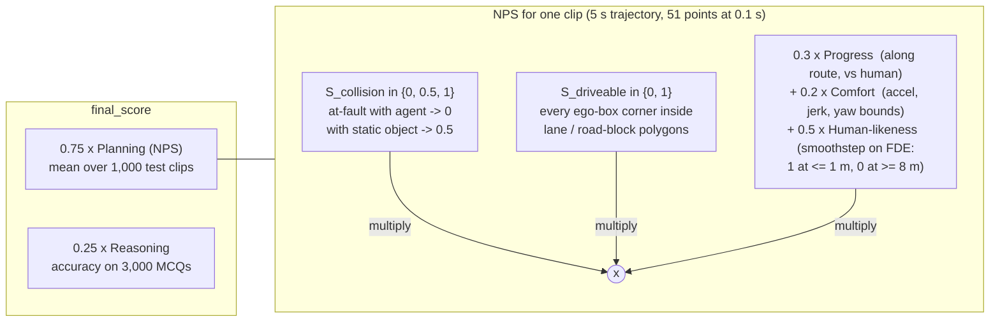

**Where the planning points are** (validation, "perfect head" ceilings: feed the chooser the true value of one sub-score):

| if we knew perfectly... | validation NPS | gain over 0.587 |
|---|---|---|
| how far the car goes (progress + human-likeness) | 0.754 | **+0.168** |
| whether a candidate collides | 0.666 | +0.079 |
| whether a candidate stays on the road | 0.608 | +0.022 |
| the annotated driving decision (stop / slow / keep / go) | 0.622 | +0.035 |
| every object's position and velocity | 0.604 | +0.018 |

The big lever is **how far the car goes**, and it depends on *scene state* (light colour, whether the lead car moves), which only the cameras show.

---

## 2. System overview

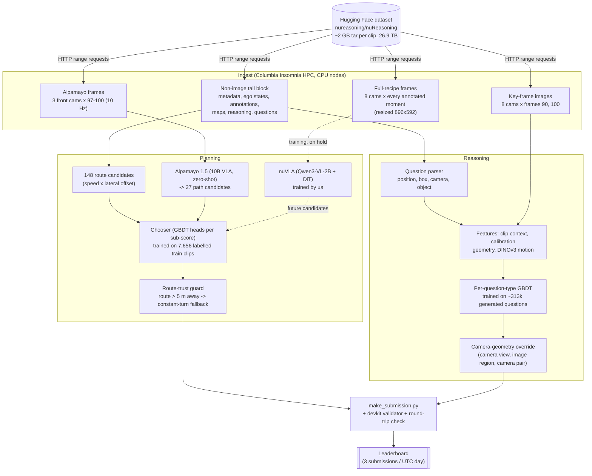

---

## 3. Data: how 26.9 TB is read without downloading it

Each clip is one ~2 GB tar on Hugging Face. We never download whole tars: we read the tar *headers* with HTTP range requests, find where each file sits, and fetch only the bytes we need.

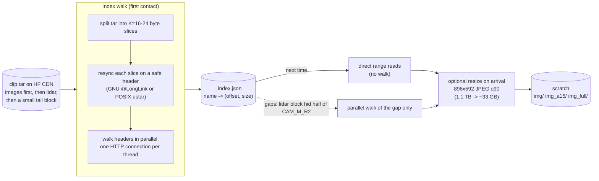

| what | images | status |
|---|---|---|
| non-image tail (all 11,890 clips) | 0 | done |
| key frames 90/100, 8 cams (train 7,656 + val + test) | 16 / clip | done |
| Alpamayo 10 Hz frames 97-100, 3 front cams | 12 / clip | done (all splits) |
| full-recipe nuVLA frames (every annotated moment + 1 s history, 8 cams) | 112 / clip | fetching |
| Alpamayo fine-tune frames (moments -1..-3, 3 cams) | 117 / clip | queued after the above |

Hard-won details (all in the ledger): HF caps ~112 MB/s and ~380 req/s per account; tars mix GNU and POSIX headers; HTTP connections must never be shared across threads (heap corruption); tokens never in command-line arguments on shared nodes.

---

## 4. Planning: the menu and the waiter

**Analogy.** For each clip we write a *menu* of possible 5-second trajectories, and a trained *waiter* picks one. If the waiter always picked the best dish we would score 0.880 on validation; it actually scores 0.628 (v7.1; 0.613 in v6.2). The menu is good; the waiter is the bottleneck.

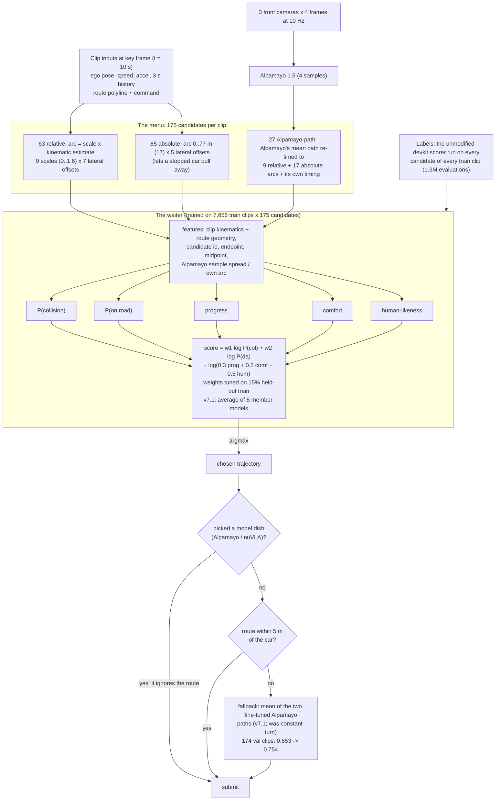

### Where the menu is going: one chooser, many sources

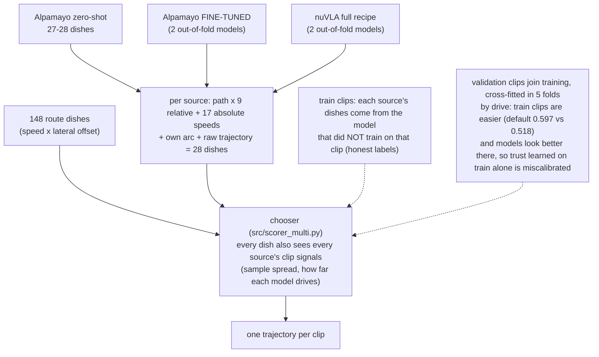

Validation, averaged over seeds (single runs vary by about ±0.006; see §8):

| chooser | mean validation |
|---|---|
| zero-shot Alpamayo, train only (the single-seed "0.6213") | 0.6133 (5 seeds) |
| fine-tuned Alpamayo, train only | 0.6141 (5 seeds) |
| fine-tuned Alpamayo, + validation cross-fitting | 0.6218 (5 seeds) |
| **fine-tuned Alpamayo, cross-fitting, 5-model ensemble (v7.1)** | **0.6278 (3 seeds)** |
| zero-shot Alpamayo, cross-fitting, 5-model ensemble | 0.6260 (3 seeds) |

| planning version | validation (849 clips) | test (leaderboard) |
|---|---|---|
| route-follow default candidate (test: v1.2) | 0.518 | 0.6043 |
| waiter over 148 candidates (v4.1) | 0.587 | 0.6998 |
| waiter over 148 + 27 Alpamayo (v6.2) | 0.613 | **0.7112** |
| v7.1: 148 + fine-tuned Alpamayo (half models), cross-fitted, ensembled | 0.628 | 0.7136 |
| v7.2: same, Alpamayo fine-tuned on ALL train clips | 0.633 | 0.7107 |
| oracle waiter over 175 | 0.878 | n/a |

---

## 5. Thread: Alpamayo 1.5

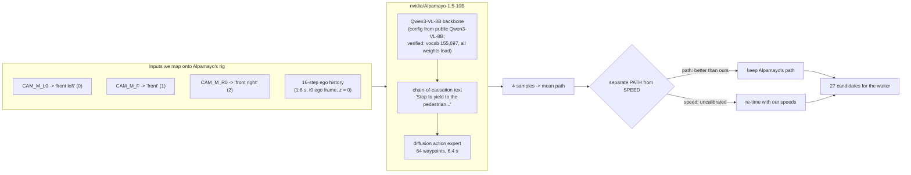

What we learned, in order (validation, 253-849 clips):

| test | NPS | lesson |
|---|---|---|
| raw Alpamayo, 1 sample | 0.496 | first (unfair) look: below our default |
| raw, mean of 4 samples | 0.542 | averaging helps |
| **Alpamayo path + our tuned speed** | **0.587** (849) | the path is excellent; its speed is the weak part |
| waiter with Alpamayo candidates | 0.613 | +0.027 over 148 candidates |

### Fine-tuning Alpamayo on our data (done)

NVIDIA recipe "stage 2": the 8B vision-language model is frozen; only the 2.3B trajectory head (flow-matching action expert) learns. The leader, SimForge, is an Alpamayo specialist (published SIMFORGE-D1.5, a distilled Alpamayo 1.5).

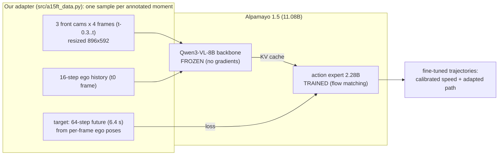

81,523 samples from 7,654 train clips, two out-of-fold models (one per half), 3 epochs on 4 GPUs each (11 h 59 min / 11 h 55 min; loss 3.95 -> 2.9). Fine-tuned trajectories replace the zero-shot Alpamayo dishes on the menu.

| same 849 validation clips | raw trajectory | its path, our speed | best of its 28 dishes |
|---|---|---|---|
| zero-shot | 0.558 | 0.542 | 0.802 |
| fine-tuned, half 0 | **0.602** | 0.591 | 0.814 |
| fine-tuned, half 1 | 0.589 | 0.571 | 0.810 |

The fine-tuned model is +0.03 to +0.045 better on its own, and its own speed now beats ours. On train clips (out-of-fold) it looks even better (0.647 vs 0.595). Train clips are easier overall (our default candidate: 0.597 on train vs 0.518 on validation), and the cause of the larger gap for learned models is not established. That gap is why the chooser needed validation cross-fitting. (An earlier explanation, "train is 2023-25, validation 2026", was a script bug: train is 81% 2026.)

## 6. Thread: nuVLA (organisers' reference model)

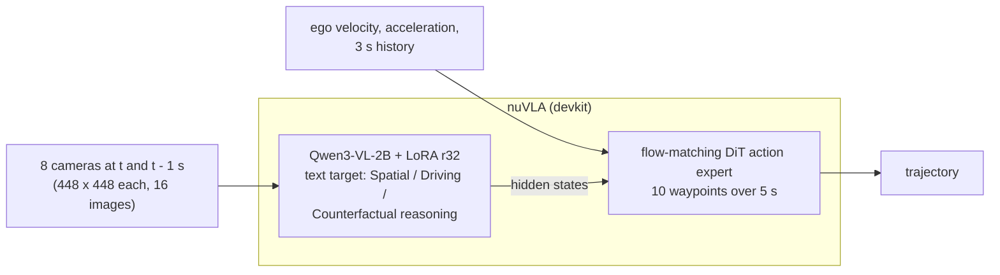

| run | training samples | validation NPS | test |
|---|---|---|---|
| ours, key frame only, epoch 1 / 2 / 3 / 4 | 7,500 (1 per clip) | 0.161 / 0.314 / 0.294 / **0.436** | not submitted |
| organisers' paper | ~13 per clip | 0.650-0.731 | baseline row: **0.7294** |
| ours, full recipe, **two half-models** (out-of-fold), epoch 1..5, half 0 | ~48,500 each | 0.354 / 0.408 / 0.524 / 0.527 / **0.541** | via chooser |
| same, half 1 (epoch 5 crashed at 91%, resume queued; epoch 4 used meanwhile) | | 0.336 / 0.459 / 0.529 / 0.531 / pending | |

**Plan (Option B):** nuVLA becomes more dishes on the chooser's menu, not a replacement. The chooser must learn from predictions nuVLA made on clips it never trained on, so we train two models on halves of the train clips (split by drive); each predicts the other half. Same GPU-hours as one full model.

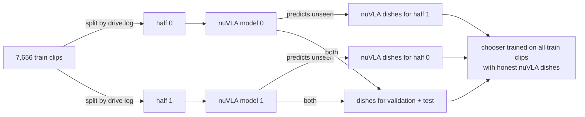

Full-recipe half 0 as a path source: raw 0.554, best of its 28 dishes 0.763; menu ceiling 0.880 -> 0.885 with it. Our 1-per-clip nuVLA was far below both our chooser (0.587) and the organisers' model. As a *candidate* for the waiter it is complementary (per-clip best of nuVLA and chooser: 0.649), but a switch trained on validation alone could not exploit it.

Devkit patches we needed ([`patches/devkit_nuvla.diff`](patches/devkit_nuvla.diff)): keep only frames whose images exist (and allow the adjacent frame); `sdpa` attention (the flash-attn fallback silently loaded fp32); lazy metadata (host-RAM crash); resume continues at the saved epoch.

---

## 7. Reasoning: answering the multiple-choice questions

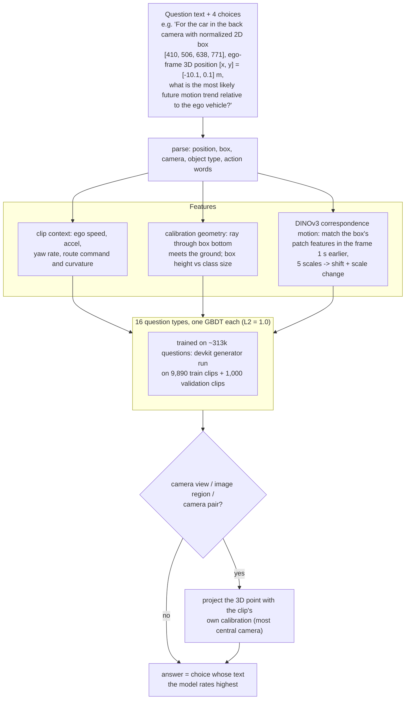

| reasoning version | held-out validation logs | test (leaderboard) |
|---|---|---|
| priors + question-text geometry (v2-v4) | 0.805 | 0.597 |
| + camera-geometry override (v5) | | 0.6150 |
| **train+val questions, motion, distance geometry (v6.1)** | **0.860** | **0.6917** |

Why the jump: fitting on 10x more generated questions. It first *collapsed* on some types; root cause was plain gradient boosting **diverging** on large data (training accuracy 0.71). L2 regularisation fixed it (0.989). A suspected 2025-vs-2026 recording-year shift was tested with train labels only and **refuted**.

**Alpamayo's own words as evidence.** Alpamayo explains each drive ("Stop to yield to the pedestrian in the crosswalk"). 26 cues extracted from that text (stop, yield, red/green light, pedestrian, construction, ...) are added to the scene-level question types only (driving decisions, action risk, unsafe action): held-out 0.860 -> **0.866** (unsafe action 0.63 -> 0.67). Ready for the next submission.

Per question type (held-out validation, current recipe): driving decision 0.90, camera pair 0.99, image region 0.93, camera view 0.97, action risk 0.84, future motion 0.77, distance 0.75, unsafe action 0.63.

**Future motion by tracking (v11.1, +0.0204 reasoning on test).** Reading the devkit generator showed the future-motion label is a fixed rule on the object's *current* closing speed (> 0.5 m/s approaching, < -0.5 moving away, else maintaining; reproduces 1,663/1,663 validation labels). So instead of a classifier: track the stated box backwards over the last second with SAM 2.1, turn box-height change into range change (the question states the exact range at frame 100), and apply the same rule. Validation 0.771 -> 0.816 on the type; on test it gained ~61 answers, more than validation predicted. SAM 3 was no better than SAM 2.1 here, and longer windows did not help.

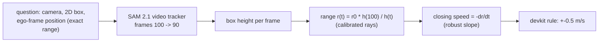

**Distance questions: two measurement routes, both below the classifier (not adopted).** The label is the object's ground-plane distance, and the wrong options are other objects' distances, so an estimate must be within ~5% to beat the classifier (0.754). Depth Anything 3 Metric with true focal lengths and SAM masks reached 0.71 after a cross-fitted per-category correction; motion parallax from the ego's own movement reached 0.64 even on truly static objects. By-product: **ego poses lead the camera timestamps by about one frame (0.1 s)**, found because static-object triangulation was biased ~1 m outward on every camera (confirmed on two independent halves of the drive logs). Lesson: run the precision check against known method accuracy *before* building.

---

## 8. How we measure (so we don't fool ourselves)

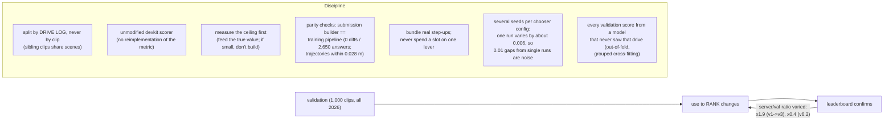

Validation predicts the *direction* of a change reliably, not its size. Lesson from 2026-09-27: a pure code-path change (passing all-ones sample weights) moved one chooser from 0.6213 to 0.6090, so chooser comparisons are now paired by seed and averaged.

---

## 9. Submission history

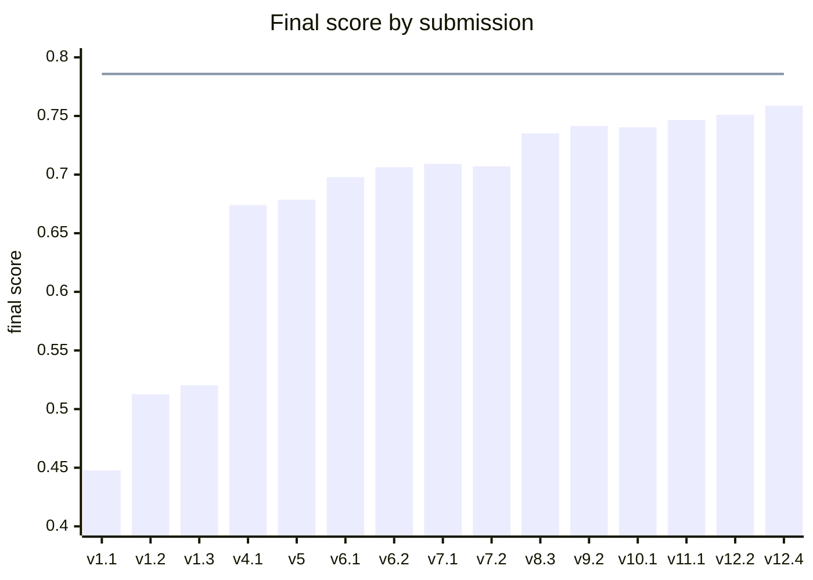
(line = current leader, SimForge 0.7682)

| version | what changed | final | planning | reasoning |
|---|---|---|---|---|
| v1.1 | smoke test: constant-velocity planner, every answer "A" | 0.4477 | 0.5115 | 0.2563 |
| v1.2 | route-follow planner, every answer "B" | 0.5127 | 0.6043 | 0.2377 |
| v1.3 | route-follow planner, every answer "C" | 0.5203 | 0.6043 | 0.2683 |
| v4.1 | waiter over 148 candidates + route guard + reasoning models | 0.6741 | 0.6998 | 0.5970 |
| v5 | + camera-geometry answers | 0.6786 | 0.6998 | 0.6150 |
| v6.1 | reasoning: train+val questions, motion, distance geometry | 0.6978 | 0.6998 | 0.6917 |
| v6.2 | planning: + 27 Alpamayo-path candidates | 0.7063 | 0.7112 | 0.6917 |
| **v7.1** | fine-tuned Alpamayo chooser (cross-fitted, 5-model ensemble), Alpamayo fallback when the route is unusable, reasoning cues | **0.7092** | **0.7136** | **0.6963** |
| v7.2 | chooser dishes from Alpamayo fine-tuned on all train clips (option A, 9.5 h on 4 GPUs); validation +0.005 on 3/3 seeds, but test lower | 0.7071 | 0.7107 | 0.6963 |
| v8.3 / v9.2 (jepa session) | blends of v7.1 with WA-JEPA (+ fine-tuned Drive-JEPA) trajectories | 0.7351 / **0.7415** | 0.7480 / **0.7566** | 0.6963 |
| v10.1 | v9.2 trajectories + Qwen3.5-4B image-model reasoning blend (+0.0095 val, lower on test) | 0.7404 | 0.7566 | 0.6920 |
| v11.1 | v9.2 trajectories + future_motion_label from SAM 2.1 tracking (box scale -> range rate -> 0.5 m/s closing rule) | 0.7466 | 0.7566 | 0.7167 |
| v12.1 | all answers from the fine-tuned Qwen-Drive-1.0-4B VLM (diagnostic) | 0.7386 | 0.7566 | 0.6847 |
| v12.2 | v11.1 + VLM on the 5 types where it wins on validation | 0.7510 | 0.7566 | 0.7343 |
| v12.4 | v9.3 trajectories (jepa) + v12.2 answers + GBDT x VLM fusion on 4 types | **0.7587** | 0.7666 | **0.7350** |

---

## 10. Lever map: everything tried

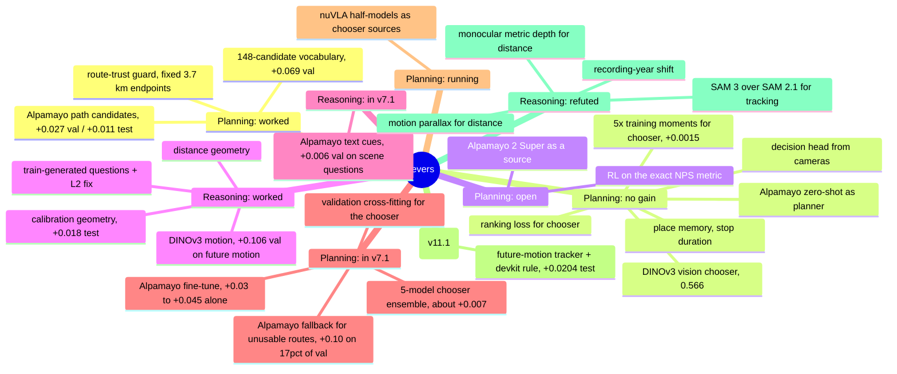

---

## 11. Compute and jobs

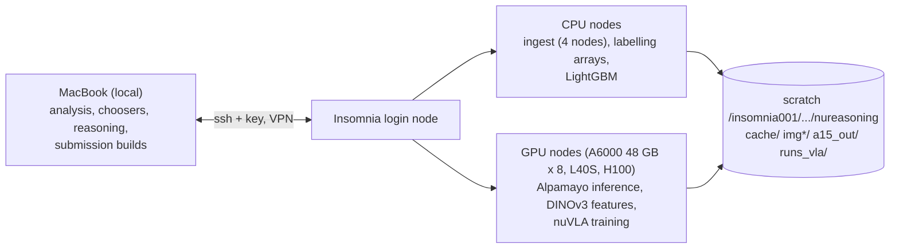

Job scripts live in [`cluster/`](cluster/). Current state is reported at each check-in.

---

## 12. Rules and integrity

- Allowed: released train/validation splits, public foundation models (Alpamayo, DINOv3, Qwen), pretraining on public data.
- Never: test labels, futures or maps; no answer inference from sibling test questions (used once as a diagnostic on 2026-09-26, then stopped; to be disclosed).
- Test clips ship no maps. Reconstructing them from train/validation maps of the same streets would amount to "recovering private maps", so we don't.
- 433 test clips share drive logs with train: any retrieval-style method must exclude same-log data.
- Disclosure for the write-up: ~35% of test questions state the object's 3D position / camera / box in the text, which our reasoning models exploit.

---

## 13. Repository layout

```
src/                      all code (ingest, planners, labellers, choosers, reasoning, submission)
cluster/                  Slurm job scripts for Insomnia
patches/devkit_nuvla.diff our changes to the organisers' devkit
pod/                      cloud-VM setup and LoRA training scripts
probe/                    early probes (tar layout, torch stub for CPU-only scoring)
```

Key entry points: `src/make_submission.py` (build + validate), `src/scorer175.py` (current chooser), `src/reason_train.py` (reasoning models), `src/label148.py` / `src/label_a15.py` (candidate labelling), `src/a15_infer.py` (Alpamayo), `src/motion_corr.py` (DINOv3 motion), `src/img_ingest2.py` + `src/tarindex.py` (ingest).
